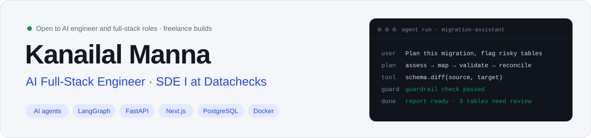

<a href="https://kanai2003.github.io">
  <picture>
    <source media="(prefers-color-scheme: dark)" srcset="assets/banner-dark.svg" />
    
  </picture>
</a>

  
  
  
  

I build AI products end to end: **the agent, the API behind it and the interface people use**. Two years shipping production software at AI startups, promoted at both. Today I build AI agents for data migration at [Datachecks](https://datachecks.io).

**Open to** AI engineer, full-stack and backend (Python) roles, full-time or contract, and a few freelance builds. [How to work with me →](https://kanai2003.github.io/hire)

## Results

| Result | Context |
| :-- | :-- |
| **1 hour → 3 minutes** | release time after I built the Datachecks CI/CD pipeline |
| **2 for 2** | promoted at both companies, each within a year of joining |
| **~1,425 req/s** | sustained by my BitTrail URL shortener at 1,000 concurrent connections |
| **150+ PRs** | authored and merged on the Buzzli platform |

## What I work on

**Datachecks** · SDE I · Apr 2025 – present
- **AI agent features end to end** with LangChain, LangGraph and FastAPI, including **Custom Guardrails** and **Memory**
- **Per-agent, per-session token tracking**, and an **AI agent that generates data migration reports**
- **CI/CD with GitHub Actions and Docker**, and the move of deployment infrastructure from **Azure to Railway**
- Backend and frontend product features across Next.js and FastAPI · [case study](https://kanai2003.github.io/projects/datachecks)

**Buzzli** · SDE intern · Mar 2024 – Mar 2025
- Full-stack LinkedIn AI copilot on **Next.js, Node.js/Express and Azure Cosmos DB**
- **News-to-post AI agent**, a **Python scraper for 25,000+ records**, SEO raised **68 → 92** · [case study](https://kanai2003.github.io/projects/buzzli)

## Featured projects

| Project | What it is | Built with |
| :-- | :-- | :-- |
| [**BitTrail**](https://kanai2003.github.io/projects/bittrail) | URL shortener with async analytics, load-tested to ~1,425 req/s · [code](https://github.com/Kanai2003/path-to-sde2/tree/main/projects/url_shortener) | FastAPI, PostgreSQL, Redis Streams, Docker |
| [**Lynx API**](https://kanai2003.github.io/projects/lynx-api) | Local-first API client that chains requests into visual workflows · [demo](https://youtu.be/N6RANaIyynI) | Next.js, TypeScript, React Flow |
| [**codebase-tracker**](https://github.com/Kanai2003/codebase-tracker) | CLI on npm that maps component and function usage across a codebase | Node.js, AST parsing |
| [**unicode-transformer**](https://github.com/Kanai2003/unicode-transformer) | npm package for styled Unicode text, and back again | TypeScript |

Also: cross-platform build fixes in [neutralino.js](https://github.com/neutralinojs/neutralino.js) and Hacktoberfest contributions. I'm learning backend depth and system design in public in [path-to-sde2](https://github.com/Kanai2003/path-to-sde2).

## Stack

  

**AI:** LangChain · LangGraph · AI agents · guardrails and memory · token tracking · OpenAI · Gemini 
**Learning now:** RAG pipelines · LLM evaluation · microservices · Kubernetes

## Trophies

<picture>
  <source media="(prefers-color-scheme: dark)" srcset="https://raw.githubusercontent.com/Kanai2003/Kanai2003/output/trophies-dark.svg" />
  
</picture>

## Activity

<picture>
  <source media="(prefers-color-scheme: dark)" srcset="https://raw.githubusercontent.com/Kanai2003/Kanai2003/output/github-contribution-grid-snake-dark.svg" />
  
</picture>

Live stats, npm packages and merged PRs: <a href="https://kanai2003.github.io/open-source">kanai2003.github.io/open-source</a>
